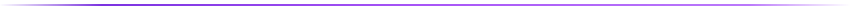

  

  

  

<table>
  <tr>
    <td width="65%" valign="middle">
      <h3>✨ Sobre Mim</h3>
      

        Sou estudante de Análise e Desenvolvimento de Sistemas na <b>C.E.S.A.R School</b>. Apaixonado por transformar ideias em soluções funcionais através de código, transitando com fluidez desde a concepção de APIs seguras e escaláveis no back-end até interfaces dinâmicas, intuitivas e agradáveis no front-end.
      

      

        Focado na construção de sistemas web robustos, explorando arquiteturas modernas, bancos de dados relacionais e não-relacionais, e ferramentas que proporcionem uma excelente experiência de usuário.
      

    </td>
    <td width="35%" align="center" valign="middle">
      
    </td>
  </tr>
</table>

  

## 🛠️ Tecnologias & Stacks

  

  
<b>🔍 Ver tecnologias separadas por categoria</b>

   

  **Linguagens**
  

    
    
    
    
    
  

  **Frameworks & Web**
  

    
    
    
    
    
    
  

  **Bancos de Dados & Storage**
  

    
    
    
  

  **Ferramentas & SO**
  

    
    
    
  

  

## 📌 Projetos em Destaque

| 🏥 Clinical Management System | 🚀 Plataforma de Estágios Web |
| :--- | :--- |
| Sistema modular para gestão médica com foco em eficiência operacional e segurança de dados. | Aplicação Full Stack em formato CRUD conectando empresas e novos talentos. |
| **Stack:** `Spring Boot` • `Angular` • `PostgreSQL` | **Stack:** `Flask` • `Python` • `JavaScript` • `HTML/CSS` |

| 🕹️ Jogo Educacional em C | 🏢 Gestão de Empresas |
| :--- | :--- |
| Jogo interativo via terminal Linux com temática da praia de Boa Viagem, estrutura modular com Makefile e GDB. | Aplicação de terminal com operações completas de CRUD e persistência estruturada de dados. |
| **Stack:** `C` • `Makefile` • `Linux` • `GDB` | **Stack:** `Python` • `JSON` • `Terminal CLI` |

  

## 📊 Estatísticas

  
  

  

## 📫 Vamos nos conectar?

  
  &nbsp;&nbsp;
  

  

